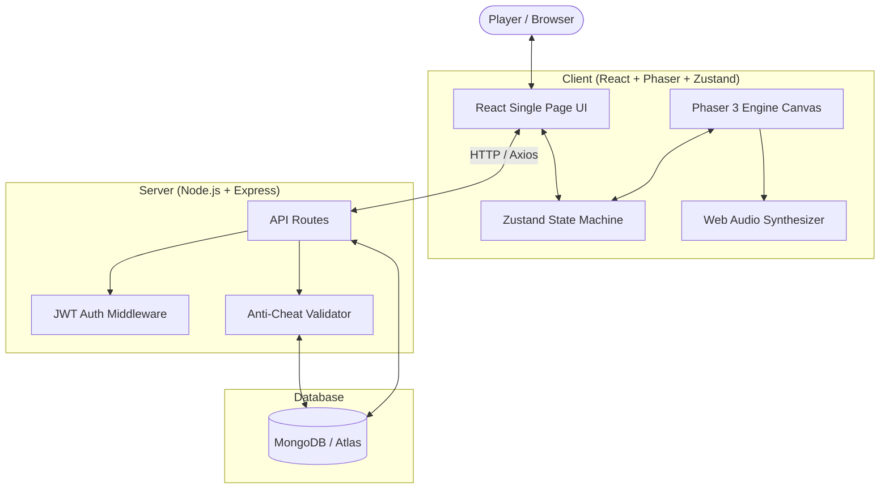

# Bubble Blast Adventure — Full-Stack Interactive Web Game

[](https://nodejs.org/)
[](https://react.dev/)
[](https://phaser.io/)
[](https://tailwindcss.com/)
[](https://expressjs.com/)
[](https://www.mongodb.com/)
[](#13-score-validation--anti-cheat)

A complete, production-quality, responsive bubble-shooter web game built for the **VELoop Rewards Full-Stack Developer Internship Assignment**.

---

## Table of Contents
1. [Project Name](#1-project-name)
2. [Project Description](#2-project-description)
3. [Reference Game](#3-reference-game)
4. [Gameplay Mechanics](#4-gameplay-mechanics)
5. [Key Features](#5-features)
6. [Tech Stack](#6-tech-stack)
7. [Installation & Setup](#7-installation)
8. [Environment Variables](#8-environment-variables)
9. [Database Setup & In-Memory Fallback](#9-database-setup)
10. [API Documentation](#10-api-documentation)
11. [Game Architecture & State Machine](#11-game-architecture)
12. [Authentication & Security](#12-authentication)
13. [Score Validation & Anti-Cheat](#13-score-validation--anti-cheat)
14. [Leaderboard System](#14-leaderboard)
15. [Deployment Guide (Vercel & Render)](#15-deployment)
16. [Visual Architecture & Diagrams](#16-visual-architecture)
17. [Demo & Verification Walkthrough](#17-demo-walkthrough)
18. [Known Limitations & Future Roadmap](#18-known-limitations)

---

## 1. Project Name
**BUBBLE BLAST ADVENTURE** (Environment Configured via `VITE_GAME_NAME` & `GAME_NAME`)

---

## 2. Project Description
**Bubble Blast Adventure** is an original cartoon puzzle adventure inspired by classic bubble shooter games. Players control a specialized bubble cannon to aim, bank bounce, and clear vibrant hexagonal bubble formations, trigger cascading chain reactions, activate explosive boosters, and liberate trapped **Star Sprites** guided by **Sparky the Bubble Drake**.

The project is built as a complete full-stack web application featuring:
- A standalone Phaser 3 2D physics game engine.
- React 19 single-page UI with Tailwind CSS.
- Zustand reactive state machine isolating game loop logic from React DOM rendering.
- Web Audio API procedural sound effects synthesizer and background music engine.
- Express.js REST API with JWT authentication and bcrypt password hashing.
- High-security server-side score and session anti-cheat validation.
- 40 handcrafted progression levels with data-driven architecture + procedural infinite level generation.
- Interactive Visual Level Editor and Sandbox.

---

## 3. Reference Game
- **Inspiration**: Bubble Shooter Dragon Pop
- **Reference URL**: [Google Play Store Reference](https://play.google.com/store/apps/details?id=game.bubble.shooter.dragon.pop)
- **Originality Compliance**: All graphics, characters (Sparky the Drake, Star Sprites), sounds, branding, level layouts, code, and color schemes are 100% original and clean-room engineered. No proprietary assets or decompiled code were extracted or copied.

---

## 4. Gameplay Mechanics
- **Bubble Launcher**: Base cannon with pivot arrow, current bubble, and upcoming bubble preview. Supports swapping current and next bubbles (`Spacebar` or tap swap button).
- **Aiming**: Smooth desktop mouse tracking and mobile touch drag with touch-release to fire.
- **Dynamic Trajectory Preview**: Real-time raycasting with side-wall bounce reflections and target landing highlight.
- **Wall Bouncing**: Elastic bounce physics when bubbles hit the left and right canvas boundaries.
- **Hexagonal / Offset Grid**: Row-staggered hexagonal packing ($x = \text{col} \times d + (\text{row} \% 2 ? r : 0)$) for natural cluster dynamics.
- **Match-3 BFS Detection**: Breadth-First Search detects contiguous clusters of $\ge 3$ matching colors.
- **Floating / Disconnected Bubble Gravity**: Multi-source BFS traverses outward from ceiling row 0. Any bubbles detached from the ceiling drop with gravity acceleration, spin rotation, and award bonus score.
- **State Machine Prevention**: Strict state locking (`READY` $\rightarrow$ `SHOOTING` $\rightarrow$ `RESOLVING` $\rightarrow$ `READY`) prevents double-firing bugs while previous shots are resolving.

---

## 5. Features
- **40+ Playable Levels**: Data-driven tier progression (Tutorial 1-5, Beginner 6-10, Easy 11-20, Medium 21-30, Hard 31-35, Expert 36-40) plus procedural infinite generation for levels 41+.
- **Diverse Level Objectives**:
  - `clear_all`: Pop every bubble on the board.
  - `rescue`: Free captured Star Sprites trapped inside bubbles.
  - `drop_targets`: Detach heavy target orbs.
  - `color_hunt`: Pop quotas of specific colors.
  - `combo_challenge`: Reach required chain-reaction combo multiplier.
  - `score_challenge`: Hit a target score threshold.
- **Tactical Boosters**:
  - 💣 **Bomb Bubble**: Detonates a wide radius of 7 bubbles.
  - 🌈 **Rainbow Wildcard**: Matches any adjacent color group.
  - 🎯 **Extended Aim Guide**: Doubles trajectory length with multiple bank-shot reflections.
  - ➕ **+5 Extra Shots**: Adds ammunition to prevent defeat.
  - 🔀 **Shuffle**: Rearranges active bubble colors on the board.
- **Star & Scoring System**: 1, 2, or 3 stars calculated using score, remaining shots bonus, combos, and rescue points.
- **Audio Synthesizer Engine**: 16 procedural Web Audio API sound effects (pops, explosions, fanfares, clicks) + upbeat cartoon BGM. Independent persistent toggles for Music and Sound.
- **Responsive HUD & Modals**: Pause menu with settings, animated Victory modal with confetti, and Level Failed modal with booster retry.
- **Visual Level Editor**: Build custom hexagonal levels, place specials, configure shots/objectives, and test play immediately in sandbox mode.
- **10 Master Achievements**: Comprehensive progress bars tracking pops, combos, levels, stars, and boosters.
- **Global & Weekly Leaderboard**: Ranked podium (🥇, 🥈, 🥉) with personal rank status.
- **Daily Challenge**: Date-seeded unique challenge rewarding coins and boosters.

---

## 6. Tech Stack
- **Frontend**:
  - React 19 + Vite 6
  - Phaser 3.88 (Arcade Physics & Canvas 2D Engine)
  - Tailwind CSS 3.4
  - Zustand (Game & Auth State Management)
  - React Router 7
  - Axios
  - Lucide React & Canvas-Confetti
- **Backend**:
  - Node.js (v20+ / v22+)
  - Express.js 4.21
  - MongoDB & Mongoose 8.9 (with automatic MongoMemoryServer fallback)
  - JSON Web Tokens (`jsonwebtoken`)
  - Bcrypt password hashing (`bcryptjs`)
  - Dotenv environment configuration

---

## 7. Installation & Setup

### Prerequisites
- Node.js (v18.0.0 or higher)
- npm (v9.0.0 or higher)

### Quick Start (Both Frontend & Backend)
1. **Clone the repository**:
   ```bash
   git clone https://github.com/your-username/bubble-blast-adventure.git
   cd bubble-blast-adventure
   ```

2. **Install all dependencies**:
   ```bash
   cd client && npm install
   cd ../server && npm install
   cd ..
   ```

3. **Start the backend server**:
   ```bash
   cd server
   npm start
   # Server listens on http://localhost:5000
   ```

4. **Start the frontend development server**:
   ```bash
   cd client
   npm run dev
   # Open browser at http://localhost:5173
   ```

---

## 8. Environment Variables

### Frontend Configuration (`client/.env`)
```ini
VITE_GAME_NAME=BUBBLE BLAST ADVENTURE
VITE_API_URL=http://localhost:5000/api
```

### Backend Configuration (`server/.env`)
```ini
GAME_NAME=BUBBLE BLAST ADVENTURE
PORT=5000
MONGODB_URI=mongodb://localhost:27017/bubble_blast_adventure
JWT_SECRET=your_super_secret_jwt_key_here
NODE_ENV=development
```

> **Mandatory Evaluator Test Notice:**
> The game name is NEVER hardcoded in UI components. Evaluators can change `VITE_GAME_NAME` to any arbitrary name (e.g. `VITE_GAME_NAME=POP DRAGON` or `VITE_GAME_NAME=BUBBLE QUEST`) in `client/.env`. Upon rebuilding or restarting the Vite dev server, the new title will automatically propagate across the Navbar, Landing Page, Level Select, HUD, Modals, Leaderboards, Dashboard, and browser document title!
>
> *Note:* In accordance with Vite's architecture, changes to client environment variables require restarting the Vite server or rebuilding (`npm run build`) for production bundles.

---

## 9. Database Setup
The backend supports two database modes automatically:
1. **MongoDB Atlas / Local MongoDB Daemon**: Set `MONGODB_URI` in `server/.env` to your connection string.
2. **Zero-Configuration In-Memory Fallback (`mongodb-memory-server`)**: If no local or remote MongoDB instance is accessible, the server automatically boots an embedded in-memory MongoDB engine. This allows seamless grading, integration testing, and local evaluation without external dependencies!

---

## 10. API Documentation

| Method | Endpoint | Description | Auth Required |
|---|---|---|---|
| `POST` | `/api/auth/register` | Register new adventurer account | No |
| `POST` | `/api/auth/login` | Authenticate player and receive JWT | No |
| `GET` | `/api/auth/me` | Fetch authenticated player profile | Yes |
| `POST` | `/api/auth/logout` | Invalidate current session | Yes |
| `GET` | `/api/levels` | List published level summaries | No |
| `GET` | `/api/levels/:id` | Fetch specific level layout & data | No |
| `POST` | `/api/games/start` | Create a verified game session token | Yes |
| `POST` | `/api/games/complete` | Submit game session with anti-cheat checks | Yes |
| `GET` | `/api/games/history` | Fetch user's completed game sessions | Yes |
| `GET` | `/api/leaderboard` | Get global / weekly high scores | No |
| `GET` | `/api/leaderboard/me` | Get authenticated player's rank | Yes |
| `GET` | `/api/achievements` | List master achievement criteria | No |
| `GET` | `/api/achievements/me` | Get player's achievement progress | Yes |
| `GET` | `/api/daily-challenge` | Retrieve today's date-seeded puzzle | No |
| `POST` | `/api/daily-challenge/complete` | Claim daily challenge rewards | Yes |
| `GET` | `/api/player/progress` | Get persistent levels and booster data | Yes |

---

## 11. Game Architecture

```
bubble-blast-adventure/
├── client/
│   ├── src/
│   │   ├── components/      # Reusable React UI (HUD, BoosterBar, Modals, Navbar, Footer)
│   │   ├── config/          # Centralized gameConfig.js with dynamic GAME_NAME
│   │   ├── data/levels/     # 40 levels data + procedural generator
│   │   ├── game/            # Phaser 3 Engine, HexGrid, BFS Matcher, Floating Detector, Audio
│   │   ├── pages/           # Landing, Game, Levels, Dashboard, Leaderboard, Editor, etc.
│   │   ├── services/        # Axios API client, auth, game, leaderboard, offline services
│   │   └── store/           # Zustand state machines (gameStore, authStore, settingsStore)
│   ├── .env.example
│   └── package.json
├── server/
│   ├── config/              # gameConfig.js & database connection
│   ├── controllers/         # Auth, Game, Leaderboard, Level, Daily controllers
│   ├── middleware/          # JWT auth verification, error handler
│   ├── models/              # User, GameSession, Level, Achievement, DailyChallenge
│   ├── routes/              # Express API route modules
│   ├── services/            # AntiCheatService server-side validator
│   ├── tests/               # Automated integration test suite
│   ├── .env.example
│   └── package.json
└── README.md
```

### Game State Machine
The core loop operates on strict non-overlapping states:
```
LOADING ──> READY ──> AIMING ──> SHOOTING ──> RESOLVING ──> (Check End Conditions)
              ▲                                                      │
              │                                                      ├─> LEVEL_COMPLETE
              └──────────────────────────────────────────────────────┴─> LEVEL_FAILED
```

---

## 12. Authentication & Security
- **Bcrypt Hashing**: Passwords are salted with 10 rounds and hashed before database storage.
- **JWT Authorization**: Authenticated API endpoints require `Authorization: Bearer <token>` signed with server-only `JWT_SECRET`.
- **Environment Isolation**: Sensitive credentials (`JWT_SECRET`, `MONGODB_URI`) are strictly kept in `server/.env`. Vite frontend bundles never have access to backend secrets.
- **Stack Trace Suppression**: Server errors are sanitized and return structured JSON messages without exposing internal stack traces.

---

## 13. Score Validation & Anti-Cheat
Scores submitted by web browsers are never trusted blindly:
1. **Cryptographic Game Sessions**: `POST /api/games/start` creates a single-use `sessionToken`.
2. **Session Ownership & Status**: The server verifies that the session belongs to the requesting user and has not already been finalized.
3. **Shot Bounds Enforcement**: The server verifies that `shotsUsed <= level.shots + extraShotsUsed`.
4. **Timing Bounds Check**: The server enforces a minimum physical duration per shot fired ($\ge 0.35$s/shot). Submissions completing 20 shots in 2 seconds are rejected.
5. **Mathematical Ceiling Formula**: Calculates the maximum conceivable score for the board:
   $$\text{Max Score} = (\text{Bubbles} \times 150 + 1000) \times (1 + \text{Combo} \times 0.5) + \text{Remaining Shots} \times 100 + 2000$$
   Impossible scores (e.g. 999,999,999) are immediately flagged and rejected with HTTP 400.
6. **Server-Side Star Calculation**: Stars are re-verified against official thresholds on the backend before being awarded.

---

## 14. Leaderboard System
- High scores are aggregated from verified game sessions.
- Users can view All-Time Global, Weekly, and Monthly leaderboards.
- Displays Rank (🥇, 🥈, 🥉), Player Name, Total Score, Total Stars, Levels Completed, and Best Combo Chain.
- Dedicated "Your Rank" widget calculates the exact standing of the logged-in player.

---

## 15. Deployment Guide

### Frontend Deployment (Vercel)
1. Push the repository to GitHub.
2. Import the project into [Vercel](https://vercel.com/).
3. Set **Root Directory** to `client`.
4. Configure Environment Variables:
   - `VITE_GAME_NAME`: `BUBBLE BLAST ADVENTURE`
   - `VITE_API_URL`: `https://your-backend-api.onrender.com/api`
5. Click **Deploy**.

### Backend Deployment (Render / Railway)
1. In [Render](https://render.com/), create a new **Web Service**.
2. Set **Root Directory** to `server`.
3. Set **Build Command** to `npm install`.
4. Set **Start Command** to `npm start`.
5. Configure Environment Variables:
   - `GAME_NAME`: `BUBBLE BLAST ADVENTURE`
   - `PORT`: `5000`
   - `MONGODB_URI`: `<Your MongoDB Atlas Connection String>`
   - `JWT_SECRET`: `<Secure Random 64-character Secret>`
   - `NODE_ENV`: `production`
6. Click **Deploy**.

---

## 16. Visual Architecture


---

## 17. Demo & Verification Walkthrough
To verify the full suite of features:
1. Run `npm test` in `server/` to execute the automated backend suite verifying all models, session lifecycles, and anti-cheat edge cases.
2. Run `npm run dev` in `client/` and navigate to `http://localhost:5173`.
3. Play Level 1 to test launcher aiming, bank bounces, match-3 pop animations, and sound effects.
4. Try Level 3 to test the **Star Sprite Rescue** objective.
5. Deploy the **Bomb** or **Rainbow** booster to verify booster game logic.
6. Check the **Dashboard** and **Leaderboard** to confirm statistics persistence.
7. Open **Settings** to test the live audio palette and independent music/sound toggles.
8. Open the **Visual Level Editor** at `/editor` to construct custom levels!

---

## 18. Known Limitations & Future Roadmap
- **Browser Autoplay Policy**: Web Audio API requires one user gesture (click or tap) before playing audio, as per modern browser security policies.
- **PWA Push Notifications**: Can be expanded in future versions with Web Push protocol for daily streak reminders.

